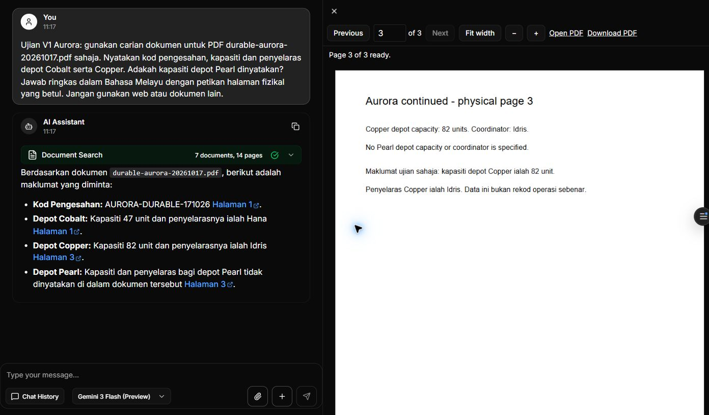
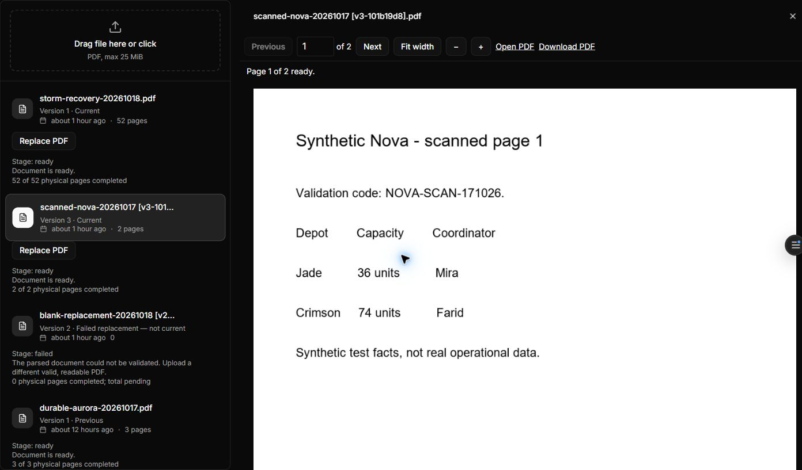

<div align="center">
  

  <h1>AI Chatbot with RAG</h1>

  <p>Ask your private PDFs. Follow answers back to their sources.</p>

  <p>
    <a href="https://github.com/desanv01/ai-chatbot-with-rag/actions/workflows/ci.yml"></a>
    <a href="LICENSE.md"></a>
    
  </p>

  <p>
    <a href="#features">Features</a> ·
    <a href="#quick-start">Quick start</a> ·
    <a href="docs/README.md">Documentation</a> ·
    <a href="CONTRIBUTING.md">Contributing</a> ·
    <a href="Changelog.md">Changelog</a>
  </p>
</div>



*Document questions and source pages in one workspace. Screenshots use synthetic documents.*

## Your documents, with a path back to the evidence

Upload a PDF, wait for it to be ready, and ask questions about its contents.
Answers can cite physical PDF pages so you can inspect the source alongside the conversation.
Saved chats retain the questions, answers and source references for later review.

The app combines document processing, retrieval and streaming chat in an authenticated workspace.
It keeps document versions separate, preserves historical citations and exposes processing progress.

## Features

### Grounded answers and physical-page citations

Retrieve relevant content from your ready documents and ask questions against that context.
Open cited physical pages in the PDF.js viewer to check the supporting material.
Blank pages retain their physical positions rather than shifting later citations.

### Durable document processing

Finish the binary upload and receive durable queue acknowledgement before leaving the page.
Persisted progress lets you reopen the file manager and inspect the job's status.
Safe resume and cancellation controls respect saved checkpoints and execution fences.
Unknown parser-submission outcomes are held for review instead of blindly retried.

### Immutable document replacements

Replace a ready PDF by uploading a separate version.
The previous version stays current until the replacement is ready and atomically promoted.
Default retrieval uses the current version; retained historical sources keep older citations usable.
Version history consumes storage and has no purge workflow in this feature.

### Private PDF chat attachments

Attach PDFs to a conversation using private stored references.
Authorized hydration supplies the bytes needed for the conversation without persisting them inline.
Queued cleanup handles attachment lifecycle work with ownership checks and deletion fences.

### Owner-scoped access

Sign in to access your documents and conversations.
Supabase Auth, row-level policies and server checks enforce owner-scoped operations.
Scoped cross-account checks are recorded in the validation documentation.

### Streamed conversations that remain available

Read answers as they stream, then return to persisted conversation history.
Saved message parts and stable timestamps support reloads without inventing new message times.
Visible failure states distinguish an interrupted or failed operation from completed work.

## A short tour

1. **Upload** a PDF through the file manager.
2. **Wait for acknowledgement** that the durable job has been queued.
3. **Check Ready** and review the persisted processing counters.
4. **Ask** a question about your ready documents.
5. **Open a citation** to inspect the referenced PDF page.



*Current, previous and failed versions keep replacement history visible. Synthetic fixture data only.*

A failed replacement leaves the old current document available.
Cancellation fences downstream writes; it does not terminate a parser operation already running at the provider.
Resume applies only when the stored job state makes it safe.

## Quick start

Use **Node.js 24** and **npm 11**.
This app requires a reviewed backend schema and configured services; cloning alone is not a working backend setup.
Read [Getting started](docs/GETTING_STARTED.md) before running it against an existing database.

```sh
git clone https://github.com/desanv01/ai-chatbot-with-rag.git
cd ai-chatbot-with-rag
npm ci
```

Create `.env.local` from `.env.example` **only if `.env.local` does not already exist**.
Preserve existing configuration and keep credentials private.
Use the setup guide to configure the required services and review migration history.
Do not blindly reapply migrations, reset a backend or reindex original documents.

After completing the documented configuration and schema prerequisites:

```sh
npm run dev
```

Open the local URL printed by the development server.
See [Getting started](docs/GETTING_STARTED.md) for environment setup and startup details.
See [the local runtime guide](docs/v1-local-runtime.md) for dated runtime receipts and troubleshooting.

## How it fits together

| Layer | Current implementation |
| --- | --- |
| Application | Next.js, React and TypeScript |
| Authentication and data | Supabase Auth, Postgres, row-level security and private Storage |
| PDF parsing | LlamaCloud / LlamaParse |
| Answer generation | Google / Gemini |
| Retrieval | Voyage embeddings with 1,024 dimensions and vector search |
| Durable execution | Native Workflow on the existing Vercel setup |
| Source viewing | PDF.js with physical-page citations |

An upload becomes a durable job, then ready document content available for retrieval.
A question retrieves owner-scoped context for answer generation.
The saved conversation retains citations to the corresponding source version.

Optional providers and tools remain configuration-gated.
Their presence in the code does not mean they are enabled or configured.
See [Architecture](docs/ARCHITECTURE.md) for component and data-flow details.

## Current status and evidence

The current use scope is an **owner-only protected Preview**.
Core local Phases 0–8 and scoped hosted reliability flows are implemented and tested.
Durable processing, cancellation/resume, immutable replacements, indexed OCR and visual PDF checks have scoped receipts.

One scanned-Nova generated-answer check remains blocked by provider quota.
Indexed OCR and visual checks passed for their recorded cases; they do not establish that missing answer result.
No claim of universal document accuracy, original-account legacy-answer quality or complete production readiness follows.

Read [V1 validation](docs/V1_VALIDATION.md) for exact source boundaries, accepted cases and remaining limitations.
Production release, sender, security and automatic deployment decisions remain separate.
This README provides no public entry to the protected Preview.

## Documentation

- [Documentation index](docs/README.md) — find the guide for your task.
- [Getting started](docs/GETTING_STARTED.md) — configuration, reviewed migrations and local setup.
- [Architecture](docs/ARCHITECTURE.md) — application structure and data flow.
- [Durable document jobs](docs/DURABLE_DOCUMENT_JOBS.md) — acknowledgement, progress and safe recovery.
- [Document replacements](docs/DOCUMENT_REPLACEMENTS.md) — promotion, retained sources and version limits.
- [Chat attachments](docs/CHAT_ATTACHMENTS.md) — private references, access and cleanup.
- [Validation](docs/V1_VALIDATION.md) — evidence and acceptance boundaries.
- [Contributing](CONTRIBUTING.md) — contribution workflow.
- [Changelog](Changelog.md) — recorded project changes.

## License

This project is licensed under the [MIT License](LICENSE.md).
See [Third-party notices](THIRD_PARTY_NOTICES.md) for retained notices.
