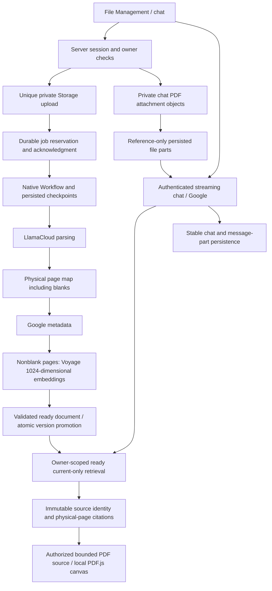

# V1 architecture

V1 retains Next.js App Router, React, TypeScript and the existing Supabase / Google-Gemini / LlamaCloud / Voyage stack. Google is the current chat and metadata provider; optional OpenAI, Anthropic and Exa capabilities remain configuration-gated.

## Document-to-answer flow

Routes and server actions validate the session/owner; database RLS, service-only RPCs and private Storage provide additional boundaries. Privileged keys and parser/run details stay server-side. Owner job APIs return safe status, messages and physical-page counters. Chat attachment references are resolved only after owner/chat checks; storing a reference does not grant access by itself.

## User-visible behavior

**Uploads:** finish the binary transfer and receive durable queue acknowledgment before relying on server continuation. A transfer started in a browser is not yet an accepted job. Once queue submission has been attempted, a lost response must not delete the source or trigger blind resubmission. Reopen or refresh processing status first. Each owner can have one active document job; visible stages are queued, parsing, metadata, indexing, ready, failed and cancelled.

**Recovery:** Resume and Cancel are offered only where the server allows them. Safe resume uses saved checkpoints; an unknown parser POST outcome (`parser_submission_unknown`) requires review, never a blind parser retry. Invalid sources, unusable parsed results (`parse_result_invalid`) and permanent parser failures cannot be repaired by repeatedly resuming the same invalid input/result; follow the readable-PDF guidance and operator review. Legacy jobs are not automatically imported or retried. Cancellation fences later database writes; it does not prove that an already-running provider parser has stopped.

**Physical pages:** parser page positions remain aligned with the source PDF. Blank pages retain their physical position and count toward progress, but receive no embedding. Validated finite 1,024-dimensional vectors and expected nonblank page coverage are required before readiness. Retrieval failures must not be presented as successful grounded answers.

**Versions:** replacement creates a new document ID and unique Storage path, rather than overwriting a source. The old ready version remains current while its candidate processes; failure leaves it active. Successful finalization atomically promotes the candidate. Default RAG includes only ready current versions, while saved historical citations resolve the original ID, title, bytes and physical page. Every retained version consumes quota. Version-series members are protected from ordinary deletion; V1 provides no version-history purge workflow.

**Chat and PDFs:** saved user/assistant/tool parts retain stable identities. Small message attachments use private objects and reference-only persisted parts; provider-bound PDF bytes are resolved with ownership and size checks. The PDF viewer fetches through the bounded authorized source helper, lazy-loads PDF.js with its bundled local worker and renders physical pages to white canvases, with text accessibility, page controls and open/download fallback. No remote viewer or PDF action execution is needed. Check source citations: generated answers may be incomplete.

| Bound | Current contract |
| --- | --- |
| Document PDF | 25 MiB per file; 2,000 physical pages. |
| Owner document storage | 150 MiB, including retained versions. |
| Parsed output | 16 MiB total; 2 MiB per page. |
| Document embeddings | `voyage-3-large`, 1,024 finite values. |
| Chat PDF attachments | At most four per message, each at most 3 MiB; combined message total at most 3 MiB. |
| Resolved attachment history | At most 12 MiB. |
| PDF canvas | At most 8 million pixels per page canvas, device pixel ratio capped at 2. |

## Operator implementation map

| Area | Source |
| --- | --- |
| Web UI and server routes | `app/`, including `app/api/document-jobs/` and upload routes. |
| Durable ingestion | `workflows/document-processing.ts`, `lib/server/document-processing-steps.ts`, `lib/server/document-jobs.ts`. |
| Dispatch and maintenance | `workflows/document-job-maintenance.ts`, `workflows/chat-attachment-maintenance.ts` and their server-side starters. |
| Attachments | `lib/server/chat-attachment-*.ts`, `lib/chat-attachment-limits.ts`. |
| PDF rendering | `components/pdf/PdfCanvasViewer.tsx`, `lib/pdf-source.ts`. |
| Schema | Seven ordered files in `supabase/migrations/`; `database/setup.sql` is historical. |
| Configuration and verification | `.env.example`, `next.config.ts`, `package.json`, `tests/offline/`, `tests/sql/`. |

Native Workflow persists run/step state while database generations, leases and run fences reject stale writes. Document dispatch is normally immediate; fallback maintenance checks at 30-minute intervals. Maintenance runs span seven days and hand off to a child run; leases last two hours. Parser polling is bounded to 360 polls at ten-second intervals, and indexing uses up to four pages in parallel. These are implementation bounds, not provider-termination or maximum-duration acceptance claims.

Attachment cleanup uses durable queue records, leases and tombstones, with an in-flight grace period and bounded retry/backoff. Chat deletion must acknowledge durable cleanup ownership before showing success. Cleanup is eventual; exhausted attempts require operator review, not blind source deletion. See [attachment operations](CHAT_ATTACHMENTS.md).

The hosted build requires Vercel System Environment Variables and fails closed without a genuine deployment ID; Local World belongs to local execution. See [setup and validated commands](GETTING_STARTED.md) for runtime fixtures and isolated SQL rollback tests. An existing valuable backend must be backed up and its applied migration history inspected; accepted migrations are already applied and must not be blindly reapplied, reset or used to reindex originals.

## Evidence and release boundary

The [dated validation record](V1_VALIDATION.md) distinguishes source/mock checks, localhost Workflow restart fixtures and actual scoped hosted behavior. Recorded synthetic cases cover durable navigation/reopening, indexing cancellation/resume, failed replacement preservation, scanned content indexing and specific readable PDF pages. They do not establish universal OCR/visual understanding, full browser-shutdown continuation, prolonged maximum-duration stress or all-document answer quality. A recorded generated-answer case remains quota-blocked; indexed facts alone do not prove its generated answer.

The operating scope remains owner-only protected Preview with current providers. Production origin/backend, sender, security, automatic deployment and release/backout decisions remain separate. This architecture introduces no authorization to change those settings, replace models or launch V2.
